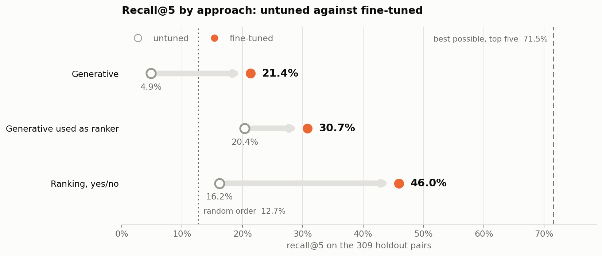
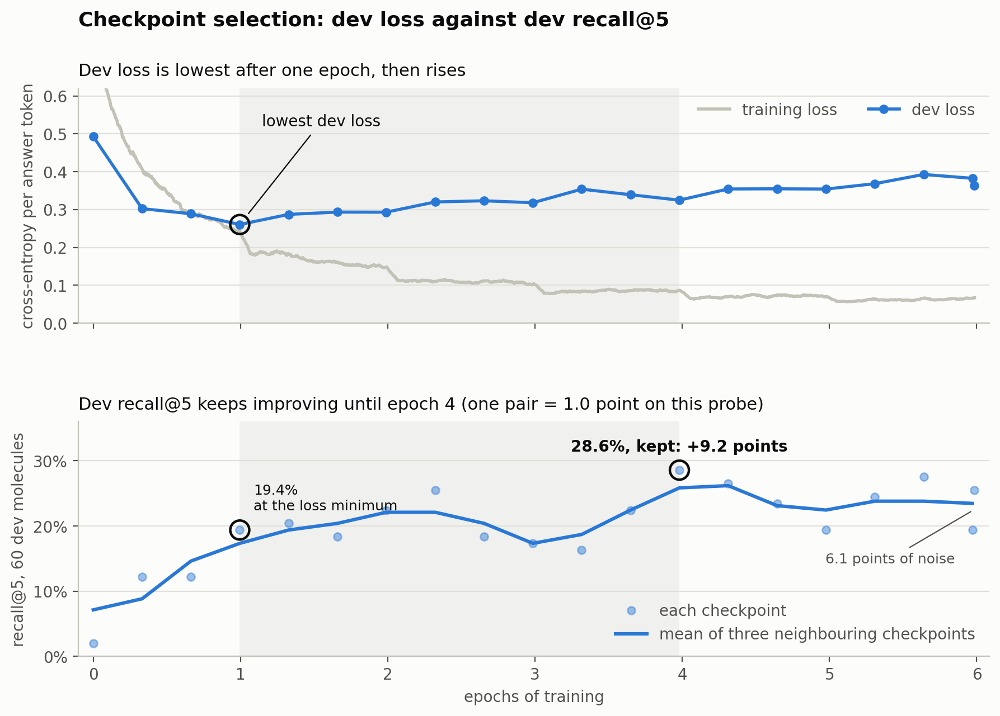
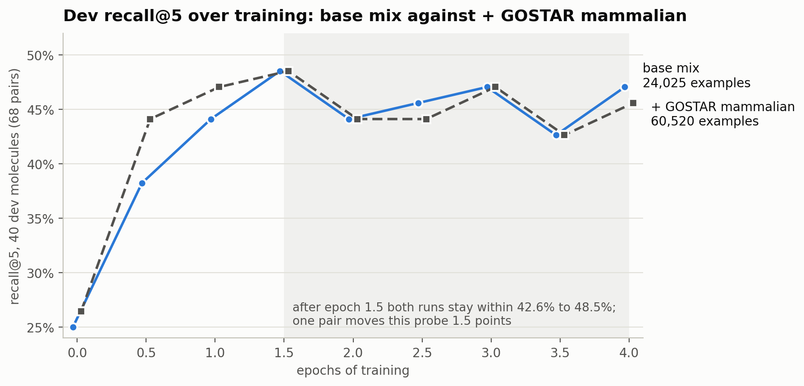
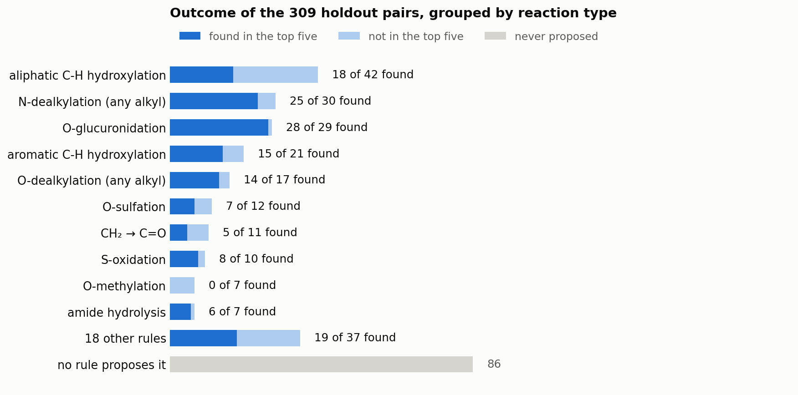

# Metabolite prediction by fine-tuning Qwen3-8B

Given a parent drug as a SMILES string, predict the structures of its metabolites. Forty-two
SMIRKS rules enumerate every candidate those rules can produce for the parent, a median of 32 per
parent. Qwen3-8B, fine-tuned with LoRA, answers yes or no for each candidate, and the five with the
highest log P(yes) − log P(no) are returned.

The full writeup is [`WRITEUP.html`](WRITEUP.html). Every measured number, with how to reproduce
it, is in [`docs/FINDINGS.md`](docs/FINDINGS.md), and the training runs are on
[W&B](https://wandb.ai/dianjiang75/metabolite-prediction).

## Results

All scores are on a held-out test set of 309 drug–metabolite pairs. Recall@5 is the share of
recorded metabolites that appear among the five predictions.

The project asked three questions.

1. **Write metabolites from scratch, or pick from rule-generated candidates?** Pick, once the
   model is trained to rank. A ranker trained directly reaches 46.0% recall@5. Reusing the
   generative fine-tune as a ranker scores 30.7%, and fine-tuned generation scores 21.4%. The
   untuned model scores 16.2% in the same yes/no format and 4.9% writing metabolites from scratch.
2. **Does more data help?** Little. Adding mammalian GOSTAR records took the ranker's training
   examples from 24,025 to 60,520 and moved recall@5 from 46.0% to 46.6%. Both runs stopped
   improving at about 1.5 epochs.
3. **Does a separate site-of-metabolism adapter help?** Only if its sites are right. Site labels
   derived from the known answers raise recall@5 from 46.6% to 61.2%. The adapter marks at least
   one labelled site for 62.6% of drugs, and filtering candidates on its predictions drops recall
   to 32.4%. A score adjustment chosen on development data keeps every candidate and reaches 47.9%
   against a 46.9% baseline, with a 95% interval of −0.7 to +2.7 points.

| # | Configuration | recall@5 | precision@5 | drugs with ≥1 hit |
|---|---|---|---|---|
| 1 | Untuned, generative (control) | 4.9% | 1.8% | 8.4% |
| 2 | Fine-tuned, generative | 21.4% | 8.5% | 36.8% |
| 3 | Fine-tuned generative used as ranker | 30.7% | 12.0% | 45.8% |
| 4 | Untuned, ranking by likelihood | 20.4% | 8.0% | 34.2% |
| 5 | Untuned, ranking (control) | 16.2% | 6.3% | 26.5% |
| 6 | Fine-tuned to rank | **46.0%** | 17.9% | 61.3% |
| 7 | Fine-tuned to rank, +GOSTAR | **46.6%** | 18.5% | 63.2% |

The test set has 309 pairs over 155 parent strings, which are 154 distinct drugs after
standardisation. Results at k = 1, 3 and 5 are in [`docs/arm_results.csv`](docs/arm_results.csv).



*Metabolite recovery across prediction approaches. The 71.5% ceiling applies to ranking the fixed
rule-generated candidate lists.*

### Against published systems

MetaTrans counts a prediction as correct when its fingerprint Tanimoto similarity to a reference
is exactly 1.0. Scoring this method's top five the same way puts all four systems on one matching
rule.

| Top-5, fingerprint equality | recall@5 | precision@5 | drugs with ≥1 hit |
|---|---|---|---|
| This method | 44.7% | 17.7% | 60.6% |
| MetaTrans | 42.5% | 23.5% | 80.0% |
| SyGMa (rule-based, 2008) | 42.4% | 23.4% | 72.3% |
| GLORYx | 30.2% | 16.6% | 64.6% |

Published figures are the top-5 window of Table 4 in Litsa, Das & Kavraki, *Chem. Sci.* 2020,
measured on their own test set.

### Training



*Generator training and model selection. Development loss was lowest after one epoch, when the
model recovered 19.4% of the development metabolites within five predictions. Recovery reached
28.6% after four epochs, and that checkpoint was kept.*



*Ranking-model training. Development recall@5 on 40 drugs carrying 68 recorded pairs. The base
set has 24,025 examples and the GOSTAR-expanded set 60,520. Each curve is one training run.*

### Where the remaining error is

A ranker can only return what the rules produce, so its score factors exactly: 46.0% overall
equals 72.2% rule coverage times 63.7% recall when the answer is reachable. The rules fail to
propose 86 of the 309 recorded metabolites, and a flawless top-five ranker of the existing lists
would reach 71.5%.

Misses also depend on the reaction. The ranker recovers 28 of 29 O-glucuronidation products but
only 18 of 42 aliphatic hydroxylations. For 14 of the 24 missed hydroxylations, another product of
the same rule made the top five, which points to the reaction site as the hard part.



*Recovery by reaction type: recovered metabolites, candidates the ranking missed, and metabolites
absent from the candidate lists. This uses the later GOSTAR scoring pass, which recovered 145 of
309 metabolites (46.9%).*

### Other results

- **Model size made no difference.** Seven untuned base models from 4B to 397B parameters spanned
  only 8.4 points on 120 molecules, too few to separate anything closer than about 10 points.
- **Pooling model-generated candidates hurt.** Adding the model's own structures to the rule
  candidates raised coverage from 72.2% to 75.1% but dropped recall@5 from 46.9% to 29.8%, most
  likely because every negative the ranker trained on came from a rule.

### How it was measured

Training used 4,276 pairs, development 437 and test 309, with splits separated by standardised
drug identity. Development data chose the saved models, and test drugs were excluded from both
training and selection. Rule development included inspection of test transformations, and 44% of
test parents share a scaffold with a training parent, so the evaluation is exploratory.

## Layout

```
data/                        the five source datasets, not included (see Data below)
  processed/                 each run's history and checkpoint record; notebook 02 writes the prepared splits here
rules/metabolism_rules.csv   42 SMIRKS transformation rules, editable without touching code
notebooks/
  01_enumeration_rules.ipynb how the rules were built and validated, with outputs
  02_data_and_evaluation.ipynb data preparation and the metric suite, with outputs
  03_finetune.ipynb          the LoRA fine-tune, its diagnostics and the checkpoint it keeps
  04_arms.ipynb              arms 1-5, scored on the same test set
  05_reranker.ipynb          trains a second adapter to RANK, scores it as arm 6
  06_experiment_tracking.ipynb publishes the saved run histories to W&B
WRITEUP.html                the writeup: summary, results, what failed, limitations, plan
WRITEUP.md                   a pointer to it, and an index of the rest of the record
docs/
  FINDINGS.md                every measured result, and where to reproduce it
  finetune_curves.png        where dev loss says to stop, against where recall peaks
  arm_comparison.png         recall@5 for each way of using the model, untuned against fine-tuned
  som_comparison.png         the site of metabolism given vs predicted, and why they differ
  misses_by_chemistry.png    which reactions the ranker misses, and where in them
  examples.html              the prompt and every arm's top five, drawn as structures
  reranker_curves.png        the two ranking runs, plotted against epochs
  arm_results.csv            the full per-arm table at k = 1, 3, 5
  published_comparison.csv   contextual results from this cohort and a different published cohort
  baselines.json             the untuned numbers, written out so nothing hard-codes them
  model_probe_results.csv    the seven-model comparison behind the choice of Qwen3-8B
SOM/
  som_oracle.ipynb           what knowing the site of metabolism is worth, measured four ways
  som_predictor.ipynb        a second adapter trained to mark the atom the body attacks
  som_results.csv            the four conditions, side by side
src/evaluation.py            the metric suite: every scored number comes from here
src/decoding.py              how raw model samples become the k reported predictions
src/inference.py             the best arm as a callable pipeline: parent SMILES in, metabolites out
app.py                       a browser interface over that pipeline
requirements.txt             pinned analysis packages and compatible interface dependencies
```

## Data

The datasets are not in this repository. Their owners license them, and one of them is commercial.
The notebooks expect five CSV files in `data/`, each with the columns `parent_smiles`,
`metabolite_smiles`, `som_smiles`, `enzyme`, `species`, `source`, `reaction`,
`parent_inchi_nostereo` and `parent_scaffold_smiles`.

| file | rows | contents | source |
|---|---|---|---|
| `drugbank.csv` | 3,088 | human parent-metabolite pairs | [DrugBank](https://go.drugbank.com), free for academic, non-commercial use under its licence |
| `gloryx.csv` | 2,364 | human parent-metabolite pairs | the GLORYx reference set, [de Bruyn Kops et al., 2021](https://doi.org/10.1021/acs.chemrestox.0c00224) |
| `metxbiodb.csv` | 2,035 | human parent-metabolite pairs | MetXBioDB, released with BioTransformer, [Djoumbou-Feunang et al., 2019](https://doi.org/10.1186/s13321-018-0324-5) |
| `gostar.csv` | 18,093 | pairs across many species, less curated | GOSTAR, a commercial database licensed by Excelra |
| `test_set.csv` | 309 | 155 held-out parents, none shared with the training files | not publicly available |

The first three are the sources MetaTrans drew on ([Litsa et al., 2020](https://doi.org/10.1039/D0SC02639E)).
These particular files were prepared from those sources and are not public, so freshly downloaded
data will differ in coverage and the reported numbers will not reproduce exactly. Any set of
parents disjoint from the training parents can stand in for the test set.

Notebooks 02 to 04 also import `get_smiles_variants` from `utils/molecule_utils.py`, a helper that
came with the datasets and is not included either. It returns a molecule's canonical SMILES plus
random SMILES spellings of the same molecule, so any RDKit implementation of that behaviour can
replace it.

Without the data, every notebook still shows its saved outputs, `data/processed/` still holds each
run's record and training history, and the interface still runs in replay mode.

## Running it

```bash
uv venv --python 3.12
uv pip install --python .venv/bin/python -r requirements.txt
uv pip check --python .venv/bin/python
```

### The interface

```bash
.venv/bin/python -m streamlit run app.py
```

Opens on <http://localhost:8501>. Enter a parent drug as SMILES, or pick one of the six examples,
and the top k metabolites come back drawn, each with the rule that produced it and the score the
ranker gave it.

Recorded metabolites appear underneath the predictions when references are available, with hits
outlined. Training-membership messages use the active ranker's candidate-label training file;
reference availability is a separate property. A recorded hit on a parent used for training does
not by itself establish generalization. The supplied test parents were excluded from weight
fitting and checkpoint selection, while their missed transformations informed rule development.

Scores come from one of two places, chosen in the sidebar. **Call the model** scores the
candidates against the checkpoint in `data/processed/reranker_run.json`, which needs
`TINKER_API_KEY` in `.env`; a 35-candidate molecule takes about 7 seconds. **Replay saved scores**
reads `SOM/som_candidate_scores.json`, which that same checkpoint produced for the 215 holdout and
dev molecules, so the interface runs with no key and no network, for those molecules only.

The notebooks save every checkpoint with a seven-day lifetime, which is enough to carry one
notebook's result into the next. The chosen checkpoint of each of the four runs, the generator,
the two rankers and the site-of-metabolism predictor, was extended to 30 days afterwards, to
21 November 2026, so the notebooks and this interface run without retraining until then. The
other checkpoints of each run still expire on their original schedule.

The sidebar shows the date live scoring stops, read from the service rather than from a file, so
it stays right when a lifetime changes. A lifetime can be set or removed at any time:

```python
import tinker
rest = tinker.ServiceClient(api_key=KEY).create_rest_client()
rest.set_checkpoint_ttl_from_tinker_path(path, 30 * 24 * 3600).result()   # 30 days
rest.set_checkpoint_ttl_from_tinker_path(path, None).result()             # no expiry at all
```

`src/inference.py` holds the pipeline and can be called without the interface:

```python
from src.inference import Pipeline
result = Pipeline().predict("CC(C)Cc1ccc(C(C)C(=O)O)cc1", source="live", k=5)
```

### The notebooks

```bash
.venv/bin/python -m notebook notebooks/
```

Run the notebooks in order. 01 and 02 reproduce their numbers from the provided data alone and
cost nothing; 02 writes the prepared training files into `data/processed/`. 03, 04 and 05 call
the Tinker API and need `TINKER_API_KEY` in `.env`.

03 trains the generator and records the chosen checkpoint's `tinker://` path in
`data/processed/finetune_run.json`; 04 reads that file, so it runs from a cold kernel without
retraining. 05 trains a separate ranking adapter and appends arm 6 to `docs/arm_results.csv`, so
it runs after 04. It is run once per training mix, and names its records after the mix:
`TRAINING_MIX = "base"` writes `reranker_base_history.csv` and `reranker_base_run.json`, and
`"base+gostar"` writes `reranker_history.csv` and `reranker_run.json`. Notebook 06 reads both, so
rebuilding the two-run comparison means running 05 twice, about 6.5 hours each. A notebook saves
its checkpoint with a seven-day TTL and records that lifetime in its run file, and 04 checks the
age against it and fails with a clear message rather than calling a checkpoint that has gone. The
four current checkpoints were extended after the fact, so their run files record the extended
lifetime instead and that check follows the real date.

**Reproducibility limits.** Sampling is unseeded and LoRA initialisation happens remotely, so
new runs can change individual predictions, curves, and measured differences. SamplingParams
accepts a seed; these runs did not set one. Repeating the generator fine-tune with an identical
recipe moved recall@5 by about four points. Ranker training variance remains unmeasured because
each mixture was trained once. Generator variability cannot supply a ranker error bar. Saved
prediction artifacts support offline scoring of the recorded runs. Rule coverage and metric
ceilings reproduce under the pinned chemistry and evaluation environment.

**What cannot be re-checked at all.** Two sets of artifacts were not kept. The arms saved their
decoded top-five lists and not the raw generations, so the effect of the `standardize()` spelling
fix on the generating arms cannot be measured after the fact (`docs/FINDINGS.md` §15). The first
replicate run's artifacts were not kept either, so every *(replicate: x)* figure in
`docs/FINDINGS.md` rests on what was recorded at the time and cannot be re-derived. Neither
affects the headline numbers, which come from the current run and are reproducible from the saved
records.

Experiment record: [https://wandb.ai/dianjiang75/metabolite-prediction](https://wandb.ai/dianjiang75/metabolite-prediction)
