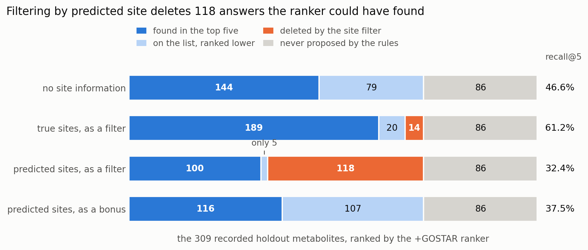

# Metabolite prediction by fine-tuning Qwen3-8B

*by Rencong (Dian) Jiang*

The task of this project is to predict the metabolites produced when the body transforms a parent
drug. The input is a SMILES string, a text format for the parent molecule, and the fine-tuned LLM
model outputs 5 metabolite predictions also in SMILES string format based on likelihood scoring.

There are three hypotheses I want to investigate as I decide how to fine-tune the model:

1. Can the model write metabolites from scratch, or does it do better picking from a list of
   rule-generated candidates?
2. Does adding mammalian GOSTAR data improve this training recipe?
3. Does a separate adapter predicting the site of metabolism (SOM) make it better?

**Pipeline:** for the ranking model in hypothesis #1, we use 42 SMIRKS rules
(`rules/metabolism_rules.csv`) to enumerate every metabolite candidate those rules can produce for
a given parent (median of 32 candidates per parent). Qwen3-8B, fine-tuned with LoRA, answers
yes/no on each and returns the five highest on `logP(yes) − logP(no)`. Training used 4,276 pairs
from DrugBank, GLORYx and MetXBioDB; GOSTAR was not included, to test hypothesis #2. For
hypothesis #3, a second LoRA adapter was trained on parent/site examples from the four sources,
with mammalian GOSTAR included and dev/test parent identities excluded from training. It outputs
the parent molecule carrying a predicted SOM label.

The arm results below come from the provided test set of 309 pairs over 155 canonical parent
strings, representing 154 standardised identities. The metric is recall@5: the share of recorded
metabolites appearing in the top five. Rule development inspected test misses, so this is an
exploratory benchmark. Published results below use a separate cohort.

| Arm | recall@5 | precision@5 | drugs with ≥1 hit |
|---|---:|---:|---:|
| Untuned, generative *(control)* | 4.9% | 1.8% | 8.4% |
| Fine-tuned, generative | 21.4% | 8.5% | 36.8% |
| Fine-tuned generative used as ranker | 30.7% | 12.0% | 45.8% |
| Untuned, ranking by likelihood | 20.4% | 8.0% | 34.2% |
| Untuned, ranking *(control)* | 16.2% | 6.3% | 26.5% |
| **Fine-tuned to rank** | **46.0%** | **17.9%** | **61.3%** |
| Fine-tuned to rank, +GOSTAR | 46.6% | 18.5% | 63.2% |

Those scores use standardised-SMILES matching. For context, the next table uses this pipeline's
fingerprint-equality score alongside published results. The populations and output budgets differ:
this project uses 155 parents / 309 pairs and five slots per parent; the publication uses 65 drugs /
179 metabolites and an approximately five-product output. These values do not establish a
competitive ranking between systems.

| Contextual results, fingerprint equality | recall@5 | precision@5 | drugs with ≥1 hit |
|---|---:|---:|---:|
| **This pipeline** | **44.7%** | **17.7%** | **60.6%** |
| MetaTrans | 42.5% | 23.5% | 80.0% |
| SyGMa (rule-based, 2008) | 42.4% | 23.4% | 72.3% |
| GLORYx | 30.2% | 16.6% | 64.6% |

*Published figures are Table 4 in [Litsa, Das & Kavraki, Chem. Sci. 2020](https://pubs.rsc.org/en/content/articlehtml/2020/sc/d0sc02639e), on a different cohort and output policy.*

**Findings.** Answers to my three hypotheses:

1. The ranking model performs best when the model is trained to rank. Reusing the generative
   fine-tune as a ranker scores 30.7%, but training a ranker directly brings the recall up to
   46.0%, while the untuned model given the same yes/no format scores 16.2% (and only 4.9% when
   writing metabolites from scratch). Broader SMIRKS coverage will raise the recall ceiling.
2. Adding mammalian GOSTAR records took training examples from 24,025 to 60,520 and moved
   recall@5 from 46.0% to 46.6%. Each mix was trained once, and the added data also changed the
   source/species mix and number of optimizer updates. This experiment leaves the benefit of
   more data unresolved.
3. Supplied answer-derived SOM annotations raise recall from 46.6% to 61.2% when used as an
   oracle filter. Predicted-site filtering drops recall to 32.4%. Retaining every candidate with
   a dominating site bonus recovers recall to 37.5%. A smaller bonus chosen on dev reaches
   47.9% against its matched 46.9% no-site baseline; the +1.0-point gain remains uncertain.

**Other findings.** Seven base models, from 4B to 397B parameters, were compared without
fine-tuning on a 120-molecule probe. Scores spanned 8.4 points, and the 27B and 4B models tied.
The small, heterogeneous probe did not establish a reliable size advantage; Qwen3-8B was a
practical choice for the subsequent experiments.

Pooling the model's own generated structures into the candidate list from SMIRKS reactions dropped
recall from 46.9% to 29.8%, most likely because every negative the ranker trained on was generated
from a SMIRKS rule, so model-generated molecules are unlike anything it was trained to judge.

| | |
|---|---|
| Code | notebooks `01`–`06`, `src/`, `SOM/` |
| Every number, with provenance | `docs/FINDINGS.md` |
| Experiment record | [wandb.ai/dianjiang75/metabolite-prediction](https://wandb.ai/dianjiang75/metabolite-prediction) |
| Time | ~30–40 hours over 3–4 days |

---

## 1. How this is scored

A molecule is written as a line of text called a **SMILES** string: `CCO` is ethanol. Drug and
metabolite are both SMILES, so a language model can attempt this as text-to-text.

**The answer key is incomplete.** Literature records that a drug produces a given metabolite, not
every metabolite it produces, so a prediction marked wrong may just be missing from the key. Hence
top-k recall: the model returns five answers and recall@5 is the share of recorded metabolites
those five catch. Extra answers are not punished as in a classification task, because an extra
answer may well be real. Because 309 test rows cover only 155 drugs, and one drug's five
predictions are scored against all of its rows, top-1 recall cannot exceed **51.5%** here.

**Splits.** The base train set contains 4,276 pairs over 2,312 parent strings, and dev contains
437 pairs over 250 parent strings. Standardised parent identities are disjoint across train, dev,
and the 309-pair test set. Dev selects checkpoints. On the generator's dev probe, the minimum-loss
checkpoint scored 9.2 points below the maximum-recall checkpoint (`FINDINGS` §12). The test set
supplies the reported arm comparisons and error analysis. Rule development used its missed
transformations, so an independently reserved cohort is needed to validate the final pipeline.

---

## 2. The result: ranking beats generating

Every arm shares one test set, one decoder and one scorer. They differ in what the model was
trained to do and what it was asked to rank. The scored table is in the summary above; every
arm's row at k = 1, 3 and 5 is in `docs/arm_results.csv`.

Random ordering of the same shortlists scores 12.8%; a flawless ranker would score 71.5%.

**The control separates the training from the prompt.** An *untuned* model given the identical
yes/no format scores 16.2%, which is 4.2 points **worse** than the same untuned model scoring by
likelihood. The format is a liability before training, so the +29.8 points from control to trained
ranker is the training.

**Published context.** The local row comes from `notebooks/05_reranker.ipynb`; the published
figures are in `docs/published_comparison.csv`.

**Concretely.** Prochlorperazine has three recorded metabolites by three chemical routes, and the
rules propose 38 candidates. The untuned model finds none in its top five; the two arms built on
the generative fine-tune each find two; only the trained ranker finds all three.

**Caveat.** The 15.2-point gap bundles four simultaneous changes: objective, training-example
format, scoring function and checkpoint-selection criterion. It measures their combined effect
as a pipeline redesign.

---

## 3. What did not work, and why

| Tried | Result | Why |
|---|---|---|
| Bigger models (4B → 397B, 7 candidates) | 8.4-pt spread | The small probe did not establish a reliable advantage. Model family and size both varied. |
| 2.5x the training examples | +0.65 pt | One run per mix; source/species composition and training updates also changed. |
| Hyperparameter search | gains unresolved | The generator varied between runs. Ranker training variance remains unmeasured. |
| Pooling the model's own guesses into the shortlist | **−17.2 pts** | Reachability rises (72.2% → 75.1%) and the shortlist doubles. Candidate-source shift may contribute to conditional recall falling from 65.0% to 39.7%. |
| Two-step enumeration | +1.6% coverage for 13.5x candidates | The second enumeration step adds five reachable reference rows on this set. |
| Free generation, untuned | 4.9%, below lookup | Copying the nearest training drug's metabolites scores 5.5%. |

**The site of metabolism offers another testable input:** which atoms participate in a
transformation. The experiments below separate the value of answer-derived annotations from the
value of a model’s predictions.

---

## 4. The site of metabolism: worth a lot, hard to use

*The figure’s bonus row uses the dominating setting (`lambda=1e6`, 37.5%). The dev-selected
setting (`lambda=0.75`, 47.9%) and its matched baseline appear in the table below.*

The supplied reacting-atom annotations are derived from known answers and may contain errors.
They provide an oracle diagnostic. Deployment requires predicted sites or independent evidence.

| Condition | recall@5 | shortlist contains answer | model picks it out |
|---|---:|---:|---:|
| No site information (original +GOSTAR ranker run) | 46.6% | 72.2% | 64.6% |
| Supplied answer-derived sites, used to filter | 61.2% | 67.6% | 90.5% |
| Predicted sites, used to filter | 32.4% | 34.0% | 95.2% |
| Predicted sites, dominating bonus (`lambda=1e6`) | 37.5% | 72.2% | n/a |
| No site bonus, matched cached-score baseline | 46.9% | 72.2% | 65.0% |
| Predicted sites, dev-selected bonus (`lambda=0.75`) | 47.9% | 72.2% | 66.4% |

**The oracle gains 14.6 points.** This measures the value of supplied answer-derived site
annotations under this filtering procedure. Their availability and accuracy differ from a model's
predictions.

**The predicted-site filter loses 14.2 points.** The adapter marks at least one correct site for
62.6% of parents. For filtering, each metabolite needs its own site retained: this happens for
105 of 223 reachable pairs, a 47% keep rate. The filter deletes 118 reachable answers. Its 95.2%
conditional recall describes only the surviving subset.

**Keeping candidates recovers 5.2 points over the gate.** A dominating site bonus preserves the
gate's preference order and retains the remaining candidates. Recall is 37.5%, compared with
32.4% for deletion. The paired parent-cluster bootstrap interval for that difference is
[+2.5, +8.3] points (`docs/paired_bootstrap.json`). Both policies remain below no-site ranking.

**The selected soft prior has an uncertain gain.** Dev selected `lambda=0.75`: a site-backed
candidate receives a 0.75 bonus to its log-odds score, with every candidate retained. This reaches
47.9% against the same scoring pass's 46.9% baseline, adding three reference hits. The paired 95%
interval is [−0.65, +2.70] points, and recall@1 changes from 18.1% to 17.8%. These intervals are
conditional on the saved predictions; training variance remains unmeasured. Improving the site
predictor, ranker, and integration of uncertain sites are all open directions.

---

## 5. What this does not establish

- **The ranker was trained once per data mix**, so its run-to-run variance is unmeasured. The
  generator’s variability does not supply an error bar for these ranker results.
- **Most figures are point estimates.** Only the two comparisons in §4 carry intervals.
- **Rule development inspected test misses**, making the final pipeline’s benchmark exploratory.
  Test parents were excluded from model training and checkpoint selection.
- **44 of the 101 test drugs with a defined scaffold share it with a training drug.** Performance
  on new molecular cores needs a separate evaluation.
- **27.8% of test answers lie outside every shortlist**, and no ranking reaches them.
- **Three reaction-rule branches need chemistry repairs:** ring-opening N-dealkylation, ester
  hydrolysis, and carbamate hydrolysis produce incorrect fragment products in checked examples.
  Their current outputs remain part of the recorded experiments.
- **Candidate labels need a consistent identity policy.** An audit found 180 groups with both
  yes/no labels across 408 training rows when stereo is removed. Several checked examples also
  conflict under full standardisation; a complete count under that criterion is still pending.
  Repairs require regenerated training data and reevaluation. Details are in
  `docs/FINDINGS.md` §21.

---

## 6. Where I would take this in three months

**Month 1: establish reliable measurement.** Define the intended use and the treatment of
stereochemistry, then repair and test the affected reaction rules and candidate labels. Freeze an
independent evaluation cohort before further optimization. Reproduce the ranking baseline, repeat
training with independent seeds, and report training variance separately from paired parent-cluster
intervals. Use development data for the changes below and open the reserved cohort once at the end.

**Month 2: test ranking and coverage separately.** Hold candidates fixed while comparing the
current yes/no objective with one pairwise or listwise alternative and training-fold hard
negatives. Then evaluate chemistry-rule expansions with the scorer fixed, tracking actual recall,
candidate count, and cost together. More reachable answers can change the difficulty of ranking,
as the pooling experiment demonstrated.

**Month 3: test uncertain site information and package the model.** Compare no-site ranking,
the dev-selected bonus, and a ranker conditioned on predicted sites. Generate training-site features
out of fold so they reflect prediction errors at deployment. Add enzyme or measured-mass/MS/MS
inputs only for a defined workflow with real observations and matched controls. Finish with the
reserved evaluation, a versioned model/rule package, a clean-install check, and blinded expert
review of representative predictions.

---

## 7. Time and compute

**About 30–40 hours over three to four days.** Roughly 13 of those were two ranking fine-tunes at
~6.4 hours each, which ran unattended. Five LoRA fine-tunes of an 8B model in total, plus a
seven-model untuned probe used to choose the base. The small probe did not establish a reliable
advantage for a larger model, so subsequent fine-tuning used 8B.
